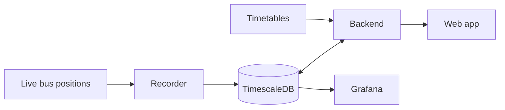

<h1>Transit Analytics <sub><sup><sub><sup>for Bialystok</sup></sub></sup></sub></h1>

[](https://github.com/twardzikfilip/transit-analytics/actions/workflows/ci.yml) [](https://github.com/twardzikfilip/transit-analytics/releases) [](.github/workflows/ci.yml) [](LICENSE)  [](https://github.com/twardzikfilip/transit-analytics/commits/main)

     

## 1. Overview
The aim of this project is to explore possibilities of an in-depth evaluation of urban public transport networks based on open data. While it is planned to generalize it for this purpose, currently the sole focus is the bus and rail network in and around the city of Białystok, Poland.

The main data source is the feed of live positions of all active vehicles from [zbiorkom.live](https://zbiorkom.live) stored and aggregated over longer span of time. This is combined with static GTFS data sets for transport companies operating in the city: [BKM](https://www.komunikacja.bialystok.pl/) - official GTFS, [PKS Nova](https://pksnova.pl/), [Wschód Express](https://wschodexpress.pl/) [PlusBus](https://plusbus.pl) - unofficial GTFS.


- **Live situation:** a live map of the buses and their delays, .
- **Service:** delay genaration and recovery time, trips cut short, dwell times, impact of bus lanes or of lack thereof, schedule regularity
- **Fleet:** vehicle utilization, .
- **Network:** route frequency, capacity;  busiest corridors, network coverage in proportion to population density, especially in the new suburban areas.
- **Areas of Improvement:** bottlenecks, unused capacities, suboptimal routes or schedules, missing links

## 2. Run
- **Main prerequisites**: Docker, Java 17 and Node 24. Python 3.9+ with numpy is only for rebuilding the map data (`tools/geo`).

```sh
docker compose up -d postgres otel-lgtm     # database (required), and Grafana on localhost:3000, (optional)
(cd backend && ./gradlew bootRun)           # API on localhost:8080; leave it running
backend/recorder/upgrade.sh                 # recording live feed from zbiorkom.live API to database
cd frontend && npm install && npm start     # the app on localhost:4200
```

Log in as `admin` / `admin` (for local use only), open **Settings** and import the Białystok timetable. The live map
works at once; pges fill up with content as positions are recorded.

## Test
- `./gradlew check` in `backend`
- `npx ng test --watch=false` in `frontend`.

## 3. Architecture



| Part | What it does | Where |
|---|---|---|
| Recorder | Stores positions every 10 s. Runs on its own, so updating the backend loses no data. | `backend/recorder` |
| Backend | Imports timetables, matches buses to trips, serves the API (Spring Boot) | `backend` |
| Web app | Maps, charts and tables (Angular, Leaflet) | `frontend` |
| Grafana | Dashboards for the recordings and the app itself | `grafana` |

One server runs it all with Docker Compose; GitHub Actions tests and releases it ([set-up](docs/server-setup.md)).

## 4. Data sources

| Data | Source |
|---|---|
| Live positions and delays | [zbiorkom.live](https://zbiorkom.live) |
| City buses timetable (GTFS) | [BKM Białystok](https://komunikacja.bialystok.pl) |
| PKS Nova 500, Wschód Express, Turośń Kościelna 700 timetables (GTFS) | unofficial feeds made from Time4Bus, [files.girlc.at](https://files.girlc.at/gtfs/) (CC0) |
| Map, borders, woods, bus lanes | [OpenStreetMap](https://www.openstreetmap.org/copyright) contributors (ODbL) |
| Residents | city and gmina registers, 2021 census, a few from Wikipedia ([details](backend/src/main/resources/places/README.md)) |

The licence of this repository doesn't cover this data: each source keeps its own terms.

## 5. TODO
tbd
